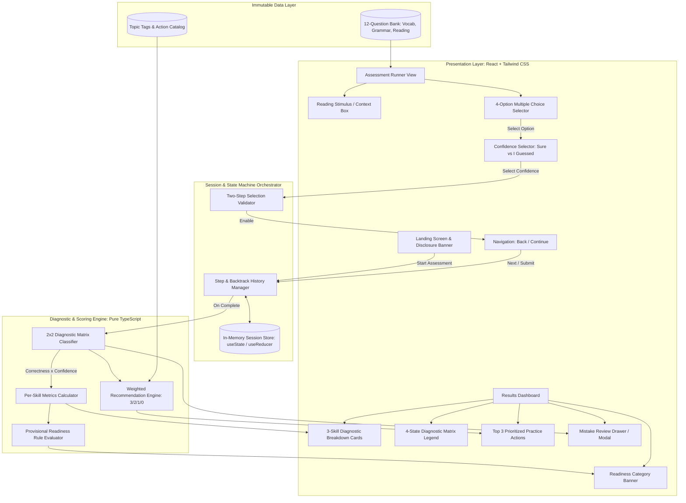
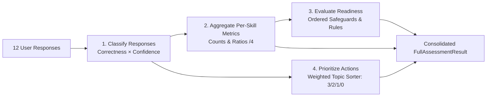
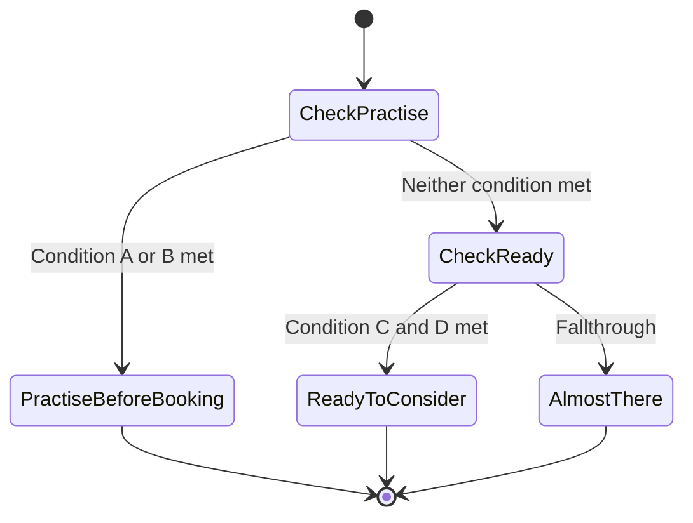
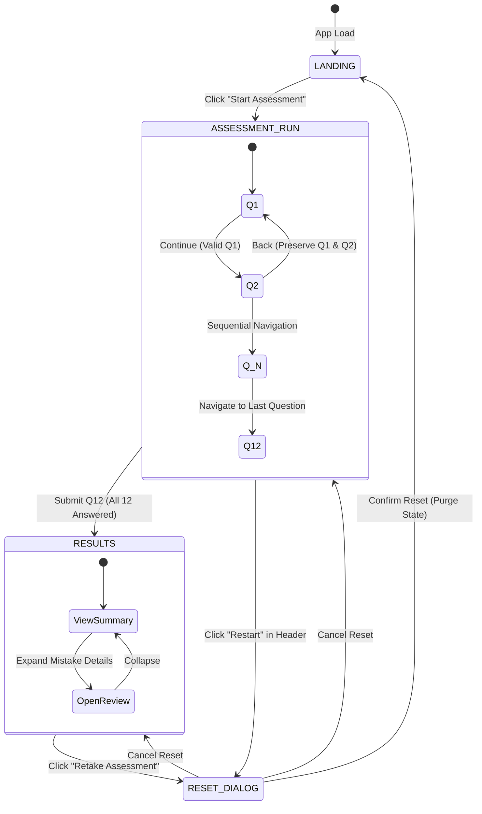
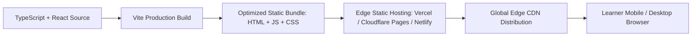

# System Architecture — Bereit? (A1 German Exam Readiness Check)

This document provides the definitive technical architecture and system design for **Bereit?**, a rapid, honest diagnostic web application for learners preparing for the Goethe-Zertifikat A1 (*Start Deutsch 1*) and ÖSD Zertifikat A1 exams.

It is derived directly from the project requirements and specifications established in [context.md](file:///c:/Nextleap%20Projects%20Git/Assg/context.md) and [problem_statement.md](file:///c:/Nextleap%20Projects%20Git/Assg/problem_statement.md).

---

## 1. Architectural Objectives & Design Principles

| Objective | Architectural Decision | Benefit |
|---|---|---|
| **Deterministic & Explainable** | Pure, client-side rule evaluation; zero stochastic/LLM elements in scoring. | 100% reproducible outcomes, zero latency, transparent student feedback. |
| **Privacy-First & Zero PII** | Client-side memory execution; no user registration, tracking cookies, or database writes. | Complete data privacy, zero compliance overhead, GDPR compliant by design. |
| **High Performance & Lightweight** | Single-page client-side bundle (Vite + React + TypeScript + Tailwind CSS). | Instant transitions, sub-second load times, functional on low-bandwidth mobile connections. |
| **Separation of Concerns** | Strict boundary between immutable question data, pure diagnostic computation, and presentation UI. | Testable business logic, modular components, maintainable code base. |
| **Accessible & Calm UX** | WCAG 2.1 AA compliant, paper-and-ink styling, keyboard-navigable, non-color-exclusive state cues. | Low anxiety for test takers, accessible to all learners. |

---

## 2. End-to-End System Architecture

The following diagram illustrates the complete runtime architecture, data flow, component boundaries, and diagnostic pipeline:



---

## 3. Data Models & Type Specifications

All domain entities, session states, and diagnostic outputs are governed by strict, immutable TypeScript interfaces.

### 3.1 Content & Question Data Models

```typescript
export type SkillCategory = 'vocabulary' | 'grammar' | 'reading';

export type CognitiveLevel = 'foundational' | 'application';

export interface QuestionOption {
  id: string;              // e.g. "q1_opt_b"
  text: string;            // Option text in German (e.g. "den Schlüssel")
}

export interface Question {
  id: string;              // e.g. "q_vocab_01"
  skill: SkillCategory;    // 'vocabulary' | 'grammar' | 'reading'
  cognitiveLevel: CognitiveLevel;
  topicTag: string;        // e.g. "accusative_articles", "public_signs"
  topicDisplayName: string;// e.g. "Akkusativ-Artikel (den/einen)"
  contextStimulus?: string;// Context for reading questions (e.g. timetable, email)
  prompt: string;          // Question prompt in German/English
  options: [QuestionOption, QuestionOption, QuestionOption, QuestionOption]; // Exactly 4
  correctOptionId: string; // ID of the single correct option
  explanation: string;     // Concise grammatical/lexical explanation
  remediationTitle: string;// Actionable practice heading
  remediationAction: string;// Actionable remediation instruction
}
```

### 3.2 Learner Response & Session State

```typescript
export type ConfidenceLevel = 'sure' | 'guessed';

export interface UserResponse {
  questionId: string;
  selectedOptionId: string;
  confidence: ConfidenceLevel;
}

export type AppScreen = 'landing' | 'assessment' | 'results';

export interface AssessmentSessionState {
  currentScreen: AppScreen;
  currentQuestionIndex: number; // 0 to 11
  responses: Record<string, UserResponse>; // Keyed by questionId
  isCompleted: boolean;
}
```

### 3.3 Diagnostic States & Scoring Metrics

```typescript
export type DiagnosticState =
  | 'secure_knowledge'    // Correct + Sure
  | 'uncertain_knowledge' // Correct + Guessed
  | 'known_gap'           // Incorrect + Guessed
  | 'potential_blind_spot';// Incorrect + Sure

export interface EvaluatedQuestionResponse {
  question: Question;
  response: UserResponse;
  isCorrect: boolean;
  diagnosticState: DiagnosticState;
  priorityWeight: number; // 3, 2, 1, or 0
}

export interface SkillScoreSummary {
  skill: SkillCategory;
  totalQuestions: 4;
  correctCount: number;
  accuracyPercentage: number;
  secureCount: number;
  uncertainCount: number;
  knownGapCount: number;
  blindSpotCount: number;
}

export type ReadinessCategory =
  | 'practise_before_booking'
  | 'ready_to_consider_booking'
  | 'almost_there';

export interface ReadinessEvaluation {
  category: ReadinessCategory;
  headline: string;
  explanation: string;
  provisionalNotice: string;
}

export interface PracticeRecommendation {
  topicTag: string;
  topicDisplayName: string;
  priorityWeight: number;
  actionTitle: string;
  actionText: string;
  triggerReason: string;
}

export interface FullAssessmentResult {
  readiness: ReadinessEvaluation;
  skillSummaries: Record<SkillCategory, SkillScoreSummary>;
  totalCorrect: number;           // Out of 12
  totalBlindSpots: number;
  evaluatedResponses: EvaluatedQuestionResponse[];
  topRecommendations: PracticeRecommendation[]; // Up to 3
}
```

---

## 4. Diagnostic & Scoring Engine Architecture

The scoring engine operates as a pipeline of four pure, deterministic functions located in `src/logic/`. It guarantees zero side-effects and is fully decoupled from the UI lifecycle.



### 4.1 Step 1: 2×2 Diagnostic Classification
For every question response $R_i = (\text{selectedOptionId}_i, \text{confidence}_i)$:

$$\text{isCorrect}_i = (\text{selectedOptionId}_i == Q_i.\text{correctOptionId})$$

$$\text{DiagnosticState}_i = \begin{cases} 
\text{secure\_knowledge} & \text{if } \text{isCorrect}_i \land (\text{confidence}_i == \text{'sure'}) \\
\text{uncertain\_knowledge} & \text{if } \text{isCorrect}_i \land (\text{confidence}_i == \text{'guessed'}) \\
\text{known\_gap} & \text{if } \neg\text{isCorrect}_i \land (\text{confidence}_i == \text{'guessed'}) \\
\text{potential\_blind\_spot} & \text{if } \neg\text{isCorrect}_i \land (\text{confidence}_i == \text{'sure'})
\end{cases}$$

### 4.2 Step 2: Per-Skill Metric Aggregation
Calculated independently for `vocabulary`, `grammar`, and `reading` ($N = 4$):
- $\text{correctCount} = \sum_{q \in \text{Skill}} \mathbb{I}(\text{isCorrect}_q)$
- $\text{secureCount} = \sum_{q \in \text{Skill}} \mathbb{I}(\text{state}_q == \text{secure\_knowledge})$
- $\text{uncertainCount} = \sum_{q \in \text{Skill}} \mathbb{I}(\text{state}_q == \text{uncertain\_knowledge})$
- $\text{knownGapCount} = \sum_{q \in \text{Skill}} \mathbb{I}(\text{state}_q == \text{known\_gap})$
- $\text{blindSpotCount} = \sum_{q \in \text{Skill}} \mathbb{I}(\text{state}_q == \text{potential\_blind\_spot})$
- $\text{accuracyPercentage} = (\text{correctCount} / 4) \times 100$

### 4.3 Step 3: Readiness Threshold Hierarchy
To eliminate edge-case conflicts, the evaluation logic strictly follows sequential prioritization:



1. **Rule 1 (Safeguard Check): `Practise before booking`**
   - Condition A: $\exists \, s \in \{\text{Vocab, Grammar, Reading}\} \text{ where } s.\text{correctCount} \le 2$
   - Condition B: $\sum_{q=1}^{12} \mathbb{I}(\text{state}_q == \text{potential\_blind\_spot}) \ge 3$
   - *Trigger:* If Condition A **OR** Condition B is true.
   - *Rationale:* Failing a single skill or harboring multiple confident misconceptions risks overall exam failure.

2. **Rule 2 (Mastery Check): `Ready to consider booking`**
   - Condition C: $\forall \, s \in \{\text{Vocab, Grammar, Reading}\}, \, s.\text{secureCount} \ge 3$
   - Condition D: $\sum_{q=1}^{12} \mathbb{I}(\text{state}_q == \text{potential\_blind\_spot}) \le 1$
   - *Trigger:* If Condition C **AND** Condition D are true.
   - *Rationale:* High accuracy backed by genuine confidence across all domains demonstrates robust readiness.

3. **Rule 3 (Default Fallthrough): `Almost there`**
   - *Trigger:* Assigned when neither Rule 1 nor Rule 2 is met.
   - *Rationale:* The learner has no catastrophic deficits, but retains fragile or guessed knowledge requiring consolidation.

### 4.4 Step 4: Weighted Practice Recommendation Engine

$$\text{Weight}(\text{state}_q) = \begin{cases}
3 & \text{if } \text{potential\_blind\_spot} \\
2 & \text{if } \text{known\_gap} \\
1 & \text{if } \text{uncertain\_knowledge} \\
0 & \text{if } \text{secure\_knowledge}
\end{cases}$$

1. Group evaluated questions by `topicTag`.
2. Compute $\text{TopicWeight}(T) = \sum_{q \in T} \text{Weight}(\text{state}_q)$.
3. Sort topics descending by $\text{TopicWeight}$.
4. **Deterministic Tie-Break:** When two topics have identical weights, rank by the **order of first appearance of that topic in the question bank**.
5. Filter out topics with $\text{Weight} = 0$.
6. Slice the top 3 topics and retrieve their remediation action details.
7. **Zero-Deficit Handling:** If all topic weights equal 0, output a positive maintenance recommendation encouraging regular revision.

---

## 5. UI Architecture & Component Hierarchy

The user interface follows a atomic, compositional component model constructed with React and Tailwind CSS:

```
src/
├── components/
│   ├── layout/
│   │   ├── Header.tsx              // Brand tagline, current phase, reset action
│   │   └── Footer.tsx              // Disclaimers, copyright, accessibility notice
│   ├── landing/
│   │   ├── LandingHero.tsx         // Value proposition ("Know before you book")
│   │   ├── ExamScopeNotice.tsx     // Transparent breakdown: What is and isn't tested
│   │   └── StartAssessmentCTA.tsx  // Action to enter assessment flow
│   ├── assessment/
│   │   ├── AssessmentRunner.tsx    // Orchestrator for questions 1 to 12
│   │   ├── ProgressBar.tsx         // Step counter (e.g. "Question 4 of 12")
│   │   ├── StimulusCard.tsx        // Formatted display for reading context/texts
│   │   ├── OptionGroup.tsx         // 4 options with accessible radio styling
│   │   ├── ConfidenceSelector.tsx  // Two-button selector: "Sure" vs "I guessed"
│   │   └── NavigationBar.tsx       // Back and Continue controls
│   ├── results/
│   │   ├── ResultsDashboard.tsx    // Complete results presentation container
│   │   ├── ReadinessBanner.tsx     // Overall readiness badge + explanation
│   │   ├── SkillBreakdownGrid.tsx  // 3-card grid (Vocabulary, Grammar, Reading)
│   │   ├── DiagnosticLegend.tsx    // Explanatory guide for the 4 diagnostic states
│   │   ├── PracticePriorityList.tsx// Top 3 ranked recommendations
│   │   ├── MistakeReviewDrawer.tsx // Collapsible list of mistakes with explanations
│   │   └── AssessmentDisclaimers.tsx // Explicit limitations & provisional disclosures
│   └── common/
│       ├── Button.tsx              // Primary, secondary, and ghost buttons
│       ├── Card.tsx                // Consistent paper-card container with subtle border
│       ├── Badge.tsx               // Semantic badges for diagnostic states
│       └── ConfirmModal.tsx        // Confirmation dialog for resetting active attempts
```

### 5.1 Component Interaction & Selection Contract
To fulfill the requirement that neither step is skipped:

```mermaid
sequenceDiagram
    autonumber
    actor Learner
    participant UI as AssessmentRunner
    participant Opt as OptionGroup
    participant Conf as ConfidenceSelector
    participant Nav as NavigationBar

    Learner->>Opt: Clicks Answer Option B
    Opt->>UI: Update selectedOptionId = "opt_b"
    UI->>Nav: Continue button remains DISABLED
    UI->>Conf: Reveal Confidence Prompt ("How sure are you?")
    Learner->>Conf: Clicks "Sure"
    Conf->>UI: Update confidence = "sure"
    UI->>Nav: Both valid -> Enable "Continue" button
    Learner->>Nav: Clicks "Continue"
    Nav->>UI: Advance to Question i + 1
```

---

## 6. State Machine & Lifecycle Transitions

The application state transitions strictly through predefined lifecycle states, preventing illegal navigation:



### State Transition Invariants
- **No Incomplete Submissions:** The application cannot transition from `ASSESSMENT_RUN` to `RESULTS` unless all 12 questions have both a `selectedOptionId` and a `confidence` recorded.
- **State Preservation on Backtrack:** When navigating backward ($Q_i \rightarrow Q_{i-1}$), all previously recorded values are retained and visually selected.
- **Atomic Reset:** Resetting an attempt completely clears the `responses` dictionary and resets `currentQuestionIndex` to 0.

---

## 7. Design System & Accessibility Engineering

Bereit? uses a bespoke design tokens palette engineered for focus, trust, and zero cognitive strain.

### 7.1 Color Palette & Semantic Tokens

| Token Name | Hex Value | Semantic Usage |
|---|---|---|
| `bg-canvas` | `#FAF9F5` | Primary application canvas (warm newsprint paper) |
| `text-ink` | `#1F2937` | High-contrast primary typography and borders |
| `text-muted` | `#6B7280` | Secondary descriptions, subheadings, labels |
| `brand-blue` | `#2563EB` | Primary CTA, progress bars, active selections |
| `brand-blue-hover` | `#1D4ED8` | Hover state for primary action buttons |
| `state-secure` | `#059669` | Secure Knowledge (paired with Check icon) |
| `state-uncertain` | `#D97706` | Uncertain Knowledge (paired with Help icon) |
| `state-gap` | `#4B5563` | Known Gap (paired with Minus icon) |
| `state-blindspot` | `#DC2626` | Potential Blind Spot (paired with Alert Triangle icon) |
| `card-bg` | `#FFFFFF` | Card backgrounds with subtle `#E5E7EB` borders |

### 7.2 Accessibility (WCAG 2.1 AA Compliance)
- **Multi-Modal Indicator Principle:** Color is **never** the exclusive conveyer of information. Every diagnostic badge pairs color with a distinct icon and explicit textual label.
- **Contrast Standards:** All text-to-background combinations meet or exceed the $4.5:1$ contrast ratio standard for normal text and $3:1$ for large headings.
- **Keyboard Navigation:** Full support for `Tab`, `Shift+Tab`, `Space`, `Enter`, and Arrow keys across option selectors and interactive review drawers.
- **Screen Reader Announcements:** Dynamic step changes and confidence reveals utilize `aria-live="polite"` regions so assistive technology conveys updates without disorientation.

---

## 8. Data Privacy, Storage & Security Architecture

Bereit? implements a zero-trust, privacy-first client-side boundary:

```
[ Client Browser ]
  ├── React Memory State (useState) <---> Ephemeral Active Attempt
  └── Static Immutable Question Bank
  
  ══════════════════════════════════════════════════════════════
  [ AIR GAP / ZERO TRANSMISSION BOUNDARY ]
  ══════════════════════════════════════════════════════════════
  
  ❌ No Backend API Endpoints
  ❌ No Database Connections (No Firebase, No Supabase, No Postgres)
  ❌ No User Authentication / Passwords
  ❌ No Analytics SDKs (No Google Analytics, No Mixpanel)
  ❌ No External Fonts or CDN Tracking
```

- **Zero Network Egress:** Once initial static assets (HTML, CSS, JS) load, the application functions 100% offline. No payload containing student responses ever leaves the browser.
- **Zero Local Persistence Overhead:** By default, attempts are stored in ephemeral React memory. Reloading or navigating away clears the state, ensuring that shared or library devices retain no user trace.

---

## 9. Verification & Automated Test Harness Architecture

To guarantee strict compliance with the scoring requirements, the codebase contains automated unit tests in `tests/`:

```
tests/
├── scoring.test.ts          // Verifies 2x2 diagnostic classification matrix
├── readiness.test.ts        // Verifies threshold boundaries and priority ordering
├── recommendations.test.ts  // Verifies weights, sorting, and tie-breaking
└── session.test.ts          // Verifies step navigation and incomplete submission blocks
```

### 9.1 Unit Test Coverage Specifications

| Test Suite | Scenario Tested | Expected Verification Outcome |
|---|---|---|
| **Diagnostic Classification** | Correct + Sure | Evaluates to `secure_knowledge`, weight = 0 |
| **Diagnostic Classification** | Correct + Guessed | Evaluates to `uncertain_knowledge`, weight = 1 |
| **Diagnostic Classification** | Wrong + Guessed | Evaluates to `known_gap`, weight = 2 |
| **Diagnostic Classification** | Wrong + Sure | Evaluates to `potential_blind_spot`, weight = 3 |
| **Readiness Rule 1 (A)** | 1 skill with 2/4 correct (e.g. Grammar) | Returns `practise_before_booking` |
| **Readiness Rule 1 (B)** | 3 blind spots across entire test | Returns `practise_before_booking` |
| **Readiness Rule 2** | All skills $\ge 3$ secure AND $\le 1$ blind spot | Returns `ready_to_consider_booking` |
| **Readiness Rule 3** | High accuracy (10/12) but with 2 guessed answers | Returns `almost_there` |
| **Recommendation Ranking** | Multiple topics with varying errors | Higher weighted topics ranked top |
| **Deterministic Tie-Break** | Two topics both have weight 3 | First encountered topic ranks higher |
| **Zero-Weight State** | 12/12 correct and sure | Returns positive maintenance recommendation |
| **Incomplete Submission** | 11 of 12 questions answered | Prevents results calculation; remains on assessment |

---

## 10. Deployment & Infrastructure Strategy

The project compiles to an ultra-compact, zero-dependency static distribution.



- **Build Output:** Standard static distribution generated via `npm run build` (`/dist`).
- **Target Platforms:** Deployable to any static host (Vercel, Cloudflare Pages, Netlify, GitHub Pages).
- **Environmental Independence:** Requires no runtime environment variables, API secrets, or proxy servers.

---

*Document generated as the comprehensive architectural specification for the Bereit? A1 Exam Readiness Diagnostic.*

