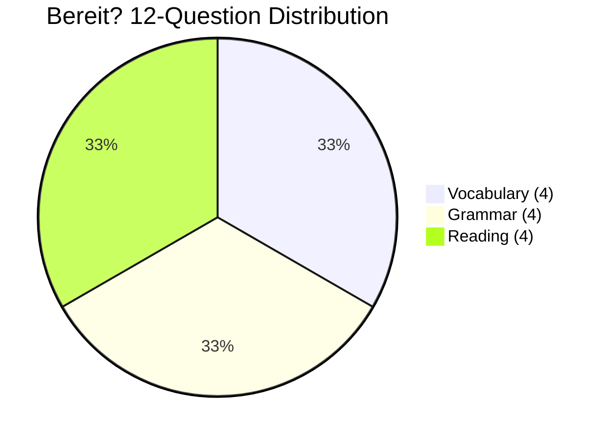
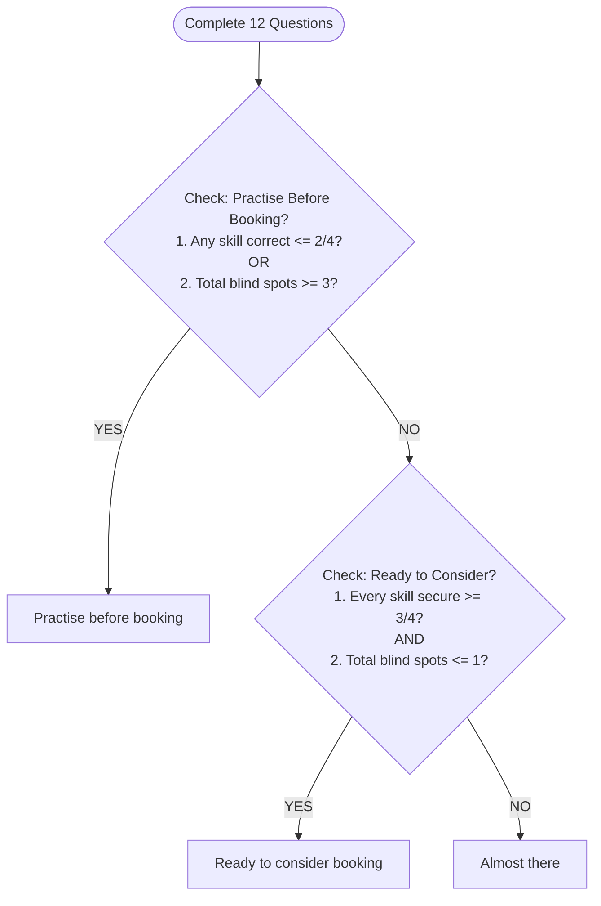
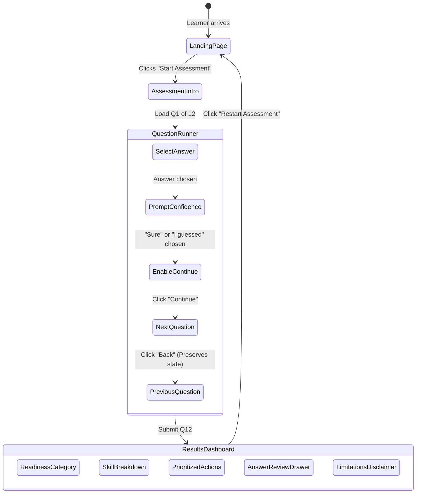

# Context Document — Bereit? (A1 German Exam Readiness Check)

## 1. Executive Summary & Product Identity

| Field | Specification |
|---|---|
| **Product Name** | **Bereit?** (German for *"Ready?"*) |
| **Product Tagline** | *Know before you book.* |
| **Product Category** | Diagnostic EdTech / Language Assessment Pre-check |
| **Target Exams** | Goethe-Zertifikat A1 (*Start Deutsch 1*) and ÖSD Zertifikat A1 |
| **Core Value** | A low-friction, 5–8 minute diagnostic assessment that reveals genuine readiness, uncovers hidden blind spots, and provides prioritized practice steps before learners invest €100+ to book an official A1 exam. |
| **Build Environment** | Antigravity (Vibe coding / agentic engineering) |
| **Document Purpose** | Single Source of Truth (SSOT) context document establishing product requirements, diagnostic logic, user experience, scoring rules, and technical boundaries for the MVP build. |

---

## 2. Problem Statement & Domain Context

### 2.1 The Problem: The "Practice vs. Readiness" Paradox
Beginner German learners (CEFR level A1) preparing for official certification through the **Goethe-Institut** or **ÖSD** spend dozens of hours practising vocabulary lists, flashcards, Duolingo, grammar drills, and YouTube tutorials. However, engaging in practice activity does not tell a learner whether they are genuinely ready to book and pass an official exam.

When learners take practice quizzes:
1. **Aggregated Percentage Scores Mask Vulnerabilities:** A single aggregate score (e.g., "75%") hides critical distinctions: Did the learner know the answers solidly, or did they eliminate two options and make a lucky guess?
2. **Hidden Blind Spots (Overconfidence):** Learners frequently harbor systematic misconceptions (e.g., confusing accusative masculine articles `den/einen` with dative, or misidentifying false friends) that they believe with high confidence are correct.
3. **Uncertain Knowledge (Underconfidence):** Learners may choose the correct option through hesitation or guessing, leading them to believe they have mastered a topic when their recall is unstable under exam pressure.
4. **Action Paralysis:** Standard practice tests tell learners what they got wrong, but fail to provide a prioritized, actionable path forward (e.g., "What exactly should I study tonight?").

> **Core Insight:** The core problem is **not** a lack of German learning material. It is the absence of a rapid, transparent, and honest diagnostic mechanism that differentiates between **secure knowledge, lucky guesses, known gaps, and overconfident blind spots**, and translates that diagnosis into immediate next steps.

---

## 3. Target User & Persona Analysis

### 3.1 Primary User Persona
* **Name Archetype:** "Pre-Booking Philippa / Priya"
* **Demographics:** Working adult, student, or spouse needing A1 certification for visa regulations (e.g., German Spouse Visa / *Ehegattennachzug*), job mobility, or university prerequisites.
* **Proficiency Level:** CEFR A1 beginner nearing the completion of their initial coursework or self-study modules.
* **Device Context:** Mobile smartphone or laptop web browser during study breaks or evening review sessions.

### 3.2 Key User Needs & JTBD (Jobs-To-Be-Done)
* **JTBD 1 (Readiness Gauge):** *"When I feel I have studied enough, I want to evaluate if I am broadly on track so that I don't risk failing a €120+ exam fee and waiting months for a retake."*
* **JTBD 2 (Confidence Calibration):** *"When I take a diagnostic, I want to separate what I genuinely know from what I guessed, so that I don't deceive myself into thinking I'm ready."*
* **JTBD 3 (Actionable Remediation):** *"When I see my gaps, I want 2–3 concrete, high-priority practice actions tied directly to my mistakes, rather than a generic textbook syllabus."*

---

## 4. Product Promise: The Three Core Questions

Upon completing Bereit?, every learner receives direct answers to three fundamental questions:

```
┌─────────────────────────────────────────────────────────────────────────┐
│                           THE BEREIT? PROMISE                           │
├─────────────────────────┬─────────────────────────┬─────────────────────┤
│ 1. Where am I right     │ 2. What do I know &     │ 3. What should I    │
│    now?                 │    what is unsure?      │    do next?         │
├─────────────────────────┼─────────────────────────┼─────────────────────┤
│ Clear, provisional      │ Transparent breakdown   │ Up to three focused,│
│ readiness classification│ across Vocabulary,      │ prioritized practice│
│ based on weakest-skill  │ Grammar & Reading via   │ recommendations with│
│ safeguards.             │ 4 diagnostic states.    │ explicit rationales.│
└─────────────────────────┴─────────────────────────┴─────────────────────┘
```

---

## 5. MVP Scope, Boundaries & Guardrails

To ensure rapid delivery, zero bloat, and surgical precision, the Bereit? MVP adheres to strict product boundaries:

### 5.1 In-Scope (MVP Core Deliverables)
- **12 Original Diagnostic Questions:** 4 Vocabulary, 4 Grammar, 4 Reading (6 foundational, 6 application).
- **Two-Step Confidence Capture:** Explicit self-reported confidence prompt ("Sure" vs. "I guessed") after selecting an answer for every question.
- **Deterministic 4-State Classification:** Mapping of (Accuracy × Confidence) into Secure Knowledge, Uncertain Knowledge, Known Gap, and Potential Blind Spot.
- **Provisional Readiness Engine:** Rule-based readiness determination (Practise before booking / Ready to consider booking / Almost there).
- **Prioritized Action Recommendation:** Weighted diagnostic scoring yielding up to 3 high-impact study recommendations.
- **Mistake Review Interface:** Detailed post-test review displaying learner choice, correct answer, and contextual explanation.
- **Disclaimers & Limitations:** Honest labeling as a preparatory diagnostic, not an official exam or pass guarantee.

### 5.2 Explicit Non-Goals (Out of Scope for MVP)
- **Official Exam Simulation:** Does not reproduce the full Goethe or ÖSD 60-to-80-minute exam format.
- **Listening, Speaking, Writing:** MVP strictly evaluates receptive written skills (Vocabulary, Grammar, Reading). Audio parsing and speech evaluation are excluded.
- **Pass Guarantees or Certification:** Bereit? never uses the words "Passed", "Failed", or "Guaranteed to Pass".
- **User Accounts & Persistence:** No authentication, passwords, backend database, cloud profiles, or cross-device syncing.
- **Monetization & Bookings:** No payment gateways, affiliate referral tracking, or official test-center booking integrations.
- **Generative AI / LLM Inferences:** No runtime AI chatbots, dynamic question hallucination, or probabilistic grading. Scoring is 100% deterministic code.
- **Full Course Content:** Bereit? is a diagnostic instrument, not an LMS, flashcard engine, or course library.

### 5.3 Core Product Principles
1. **Honesty over Reassurance:** Never inflate a learner's score to make them feel good; overconfidence leads to failed exams.
2. **Diagnosis over Scoring:** Raw percentage scores are secondary; the relationship between correctness and confidence is primary.
3. **Action over Information:** Information without immediate practice orientation causes cognitive fatigue.
4. **Explainability & Transparency:** Every readiness output and recommendation must have a simple, visible rule explaining why it was triggered.
5. **Human Understanding over AI Gimmicks:** Strict deterministic logic and curated question banks outperform flaky generative prompts.
6. **Scope Discipline:** Polish the 12-question flow to perfection before contemplating additional capabilities.

---

## 6. Diagnostic Assessment Architecture

### 6.1 Question Matrix & Distribution
The assessment consists of **12 curated, original multiple-choice questions** modeled after CEFR A1 communicative competencies:



| Skill Domain | Count | Thematic Coverage | Cognitive Mix |
|---|---|---|---|
| **Vocabulary** (*Wortschatz*) | 4 | Everyday places & public services, Food & grocery shopping, Family relationships & personal profile, Weather & seasonal clothing. | 2 Foundational<br>2 Application |
| **Grammar** (*Grammatik*) | 4 | Definite/indefinite articles & Accusative case, Regular/irregular verb conjugation, Verb-Second (*V2*) declarative word order, Negation (*kein* vs. *nicht*). | 2 Foundational<br>2 Application |
| **Reading** (*Leseverstehen*) | 4 | Short personal messages/emails, Public informational notices, Train/bus schedules & timetables, Brief classifieds/advertisements. | 2 Foundational<br>2 Application |
| **Total** | **12** | **100% aligned with Goethe Start Deutsch 1 & ÖSD A1 topics** | **6 Foundational / 6 Applied** |

#### Question Mechanics
- **Format:** 4 distinct answer options per question; exactly 1 intended correct option.
- **Stimulus/Context:** Reading questions must render authentic short context blocks (e.g., store signage, timetable snippets, mini emails).
- **Integrity Rule:** The approved 12-question bank is immutable. Question wording, distractors, correct answers, explanations, and topic tags must not be altered or simplified.

---

## 7. The Two-Step Diagnostic Classification Engine

### 7.1 Confidence Capture Mechanism
Rather than inferring confidence from answering speed (which penalizes deliberate, slow readers or non-native typists), Bereit? utilizes explicit **self-reported confidence**:

1. Learner clicks an answer option ($A, B, C, \text{or } D$).
2. The UI immediately prompts:
   > **"How sure are you about this answer?"**
   > - `[ Sure ]`
   > - `[ I guessed ]`
3. The **"Continue"** / **"Next"** button remains disabled until both an answer and a confidence selection are made.
4. Learners may freely navigate Back and Forward; their answer and confidence state are preserved.

### 7.2 The 2×2 Diagnostic Matrix
Combining binary correctness with binary confidence yields four distinct diagnostic states:

```
                      LEARNER ANSWER
                  Correct         Incorrect
              ┌───────────────┬───────────────┐
         Sure │    SECURE     │   POTENTIAL   │
              │   KNOWLEDGE   │  BLIND SPOT   │
CONFIDENCE    ├───────────────┼───────────────┤
              │   UNCERTAIN   │     KNOWN     │
      Guessed │   KNOWLEDGE   │      GAP      │
              └───────────────┴───────────────┘
```

| State Name | Correctness | Confidence | Educational Meaning & Action Required |
|---|---|---|---|
| **Secure Knowledge** | ✅ Correct | `Sure` | **Mastered.** Learner knows the concept reliably. Low priority for immediate remediation. |
| **Uncertain Knowledge** | ✅ Correct | `I guessed` | **Fragile.** Lucky guess or partial intuition. Needs reinforcement before exam pressure destabilizes it. |
| **Known Gap** | ❌ Wrong | `I guessed` | **Conscious Incompetence.** Learner is aware they do not know this topic. Straightforward to teach and study. |
| **Potential Blind Spot** | ❌ Wrong | `Sure` | **Dangerous Misconception.** High confidence in an incorrect rule. Highest priority for remediation to prevent repeated exam errors. |

---

## 8. Deterministic Scoring & Readiness Evaluation Logic

All scoring is deterministic, explainable, and reproducible in plain client-side code.

### 8.1 Per-Skill Metrics (Calculated for each of Vocab, Grammar, Reading)
For each skill ($N = 4$ questions):
- $\text{Accuracy} = \frac{\text{Correct Answers}}{4}$
- $\text{Secure Count} = \sum (\text{Correct} \land \text{Sure})$
- $\text{Uncertain Count} = \sum (\text{Correct} \land \text{Guessed})$
- $\text{Known Gap Count} = \sum (\text{Incorrect} \land \text{Guessed})$
- $\text{Blind Spot Count} = \sum (\text{Incorrect} \land \text{Sure})$

*UI Display Rule:* Always display the fraction alongside percentages (e.g., **"3 of 4 correct"**), as single-digit denominators render raw percentages misleading.

### 8.2 Overall Readiness Determination Algorithm
Readiness is categorized into one of three distinct, non-overlapping categories. To prevent edge-case ambiguity, evaluation rules **MUST** be executed in the exact priority order below:



#### Rule Execution Details

1. **Step 1: Check "Practise before booking" (Safeguard Check)**
   - Condition A: Any individual skill has $\le 2$ correct answers (out of 4).
   - Condition B: Total **Potential Blind Spots** across all 12 questions $\ge 3$.
   - *If Condition A OR Condition B is met* $\rightarrow$ Assign **"Practise before booking"**.

2. **Step 2: Check "Ready to consider booking" (Mastery Check)**
   - Condition A: In **every** skill, at least $3$ of $4$ questions are both correct and marked "Sure" ($\text{Secure} \ge 3$ for Vocab, Grammar, and Reading).
   - Condition B: Total **Potential Blind Spots** across all 12 questions $\le 1$.
   - *If Condition A AND Condition B are met* $\rightarrow$ Assign **"Ready to consider booking"**.

3. **Step 3: Default "Almost there" (Balanced In-Between)**
   - All remaining outcomes that pass the safeguard check but do not meet the strict mastery criteria $\rightarrow$ Assign **"Almost there"**.

> **The Weakest-Skill Safeguard:** An official A1 exam requires passing all sections. Compensatory scoring (e.g., getting 4/4 in Vocabulary to offset 1/4 in Grammar) is unsafe for exam takers. Bereit? enforces a strict weakest-skill barrier.

---

## 9. Practice Recommendation Prioritization Engine

### 9.1 Priority Weight Assignment
Every question is tagged with a `Topic` (e.g., `Verb-Second Word Order`, `Accusative Articles`, `Public Signs`). Recommendations are prioritized by assigning severity weights to the diagnostic state of each response:

| Diagnostic State | Assigned Priority Weight | Rationale |
|---|:---:|---|
| **Potential Blind Spot** (Wrong + Sure) | **3** | Critical misconception. Urgent correction needed. |
| **Known Gap** (Wrong + Guessed) | **2** | Acknowledged deficit. High-leverage learning opportunity. |
| **Uncertain Knowledge** (Correct + Guessed) | **1** | Fragile recall. Needs consolidation. |
| **Secure Knowledge** (Correct + Sure) | **0** | Concept already stable. No immediate drill needed. |

### 9.2 Ranking & Aggregation Workflow
1. For every question answered, map its diagnostic state to its numerical weight ($0, 1, 2, \text{or } 3$).
2. Group and sum weights by `Topic Tag`.
3. Sort topics descending by total aggregated weight.
4. **Tie-Breaking Rule:** If two or more topics have identical weight, break the tie deterministically using the **order of first appearance in the assessment**.
5. Select the **top 3 ranked topics** and present their approved remediation action title and description.
6. **Zero-Weight Fallback:** If a learner achieves a perfect score with all "Sure" selections (total weight = 0 across all topics), show a positive maintenance notification:
   > *"Great performance! All tested areas reflect secure knowledge. Continue reviewing A1 vocabulary periodically to maintain recall sharpness before your exam."*

---

## 10. End-to-End User Experience & Flow



### 10.1 Screen Breakdown

#### Screen 1: Landing Page
- **Hero & Identity:** Clear headline (*"Know before you book"*), German flag or subtle European paper aesthetic.
- **Expectation Setting:** 12 questions, 5–8 minutes, no signup required.
- **Coverage Transparency:** Explicitly states that Vocabulary, Grammar, and Reading are assessed; Listening, Speaking, and Writing are **not**.
- **Disclaimer Banner:** Emphasizes that results provide an indicator, not an official certificate.
- **Call-to-Action:** Primary button `[ Start Assessment ]`.

#### Screen 2: Assessment Runner
- **Top Bar:** Step indicator (`Question 4 of 12`), subtle progress bar, non-pressuring (no countdown timer).
- **Stimulus Box (Context):** Formatted card for Reading questions (e.g., email excerpt, notice board, schedule table).
- **Question Prompt:** Clear German question text with English instructions where necessary for clarity.
- **Answer Selection:** 4 distinct, easily tappable option cards with radio-style indicators.
- **Confidence Prompt:** Appears smoothly upon answer selection with two balanced buttons (`Sure` / `I guessed`).
- **Navigation Controls:** `[ Back ]` (enabled from Q2 onward) and `[ Continue ]` (enabled only after answer + confidence).

#### Screen 3: Results Dashboard
- **Section A: Overall Readiness Category**
  - High-visibility banner (e.g., `Practise before booking`, `Almost there`, or `Ready to consider booking`).
  - Plain-language explanation justifying the classification based on their responses.
  - Visible provisional threshold disclaimer.
- **Section B: Skill Breakdown**
  - Three distinct cards: Vocabulary, Grammar, Reading.
  - Correctness fraction (e.g., `3 of 4`).
  - Breakdown grid displaying counts for Secure, Uncertain, Known Gap, and Blind Spot with accompanying iconography.
- **Section C: Diagnostic Guide**
  - Friendly explanation defining the 4 diagnostic states so the learner understands their results.
- **Section D: Top 3 Practice Priorities**
  - Ordered 1 to 3 based on aggregated weighting.
  - Direct, concrete action text (e.g., *"Focus on masculine accusative articles (den/einen) after verbs like haben and brauchen"*).
- **Section E: Detailed Mistake Review**
  - Collapsible/expanded list of all incorrect questions.
  - Shows: Learner's choice, Correct answer, and clear grammatical/lexical explanation.
- **Section F: Assessment Disclaimers & Retake**
  - Full limitation notice.
  - `[ Retake Assessment ]` button with confirmation prompt to prevent accidental data wipe.

---

## 11. Design System & Visual Direction

The visual aesthetic reflects **academic clarity, calm confidence, and editorial quality** (avoiding both playful gamified distraction and sterile clinical exams).

```
┌─────────────────────────────────────────────────────────────┐
│                       DESIGN PALETTE                        │
├─────────────────┬─────────────────┬─────────────────────────┤
│ Canvas / Paper  │ #FAF9F5         │ Warm newsprint / paper  │
│ Ink Typography  │ #1F2937         │ Deep charcoal/ink       │
│ Muted Slate     │ #6B7280         │ Secondary labels        │
│ Primary Blue    │ #2563EB         │ Primary actions/accent  │
│ Border Grey     │ #E5E7EB         │ Clean card contours     │
│ Secure (Green)  │ #059669         │ Paired with check icon  │
│ Uncertain (Amber│ #D97706         │ Paired with help icon   │
│ Blind Spot (Red)│ #DC2626         │ Paired with alert icon  │
└─────────────────┴─────────────────┴─────────────────────────┘
```

### Visual & Accessibility Principles
- **Typography:** Headings and display text in `Bricolage Grotesque` (or clean sans-serif fallback); body text in clean legible system font (`Inter`, system UI).
- **Color Independence (WCAG 2.1 AA):** Colors are **never** used as the sole indicator of diagnostic state or readiness; every color is paired with a clear textual label and distinct SVG icon.
- **Focus & Keyboard Navigation:** Full keyboard accessibility (Tab navigation, Space/Enter selection, Esc to dismiss modals). Visible high-contrast focus rings.
- **Zero Distraction:** No countdown timers, sound effects, confetti bursts, streaks, or animated avatars.

---

## 12. Technical Architecture & Component Model

Bereit? is designed as a high-performance, zero-latency client-side Single Page Application (SPA).

```
c:\Nextleap Projects Git\Assg\
├── context.md                    <-- This Document (SSOT)
├── problem_statement.md          <-- Original Requirements Brief
├── package.json                  <-- Frontend dependencies (Vite + React + Tailwind)
├── src/
│   ├── data/
│   │   └── questionBank.ts       <-- 12 immutable questions, options, tags, actions
│   ├── types/
│   │   └── diagnostic.ts         <-- Strict TypeScript interfaces
│   ├── logic/
│   │   ├── scoring.ts            <-- Pure functions for scoring & skill metrics
│   │   ├── readiness.ts          <-- Deterministic readiness classification
│   │   └── recommendations.ts    <-- Weighted recommendation prioritizer
│   ├── components/
│   │   ├── landing/              <-- Landing view & disclaimer banner
│   │   ├── assessment/           <-- Question runner, confidence selector, nav
│   │   ├── results/              <-- Readiness badge, skill bars, recommendation list
│   │   └── review/               <-- Mistake review card with explanations
│   ├── App.tsx                   <-- State machine orchestrator (Landing -> Test -> Results)
│   └── main.tsx
└── tests/
    ├── scoring.test.ts           <-- Unit tests for 4-state mapping
    ├── readiness.test.ts         <-- Unit tests for category boundary logic
    └── recommendations.test.ts   <-- Unit tests for ranking & tie-break
```

### Technical Guardrails
1. **Separation of Content & Engine:** Questions reside in an isolated, typed data structure. Scoring logic contains zero hardcoded question strings.
2. **Pure Functional Logic:** All calculations (`calculateSkillMetrics`, `evaluateReadiness`, `rankRecommendations`) are pure functions with 100% test coverage.
3. **Zero PII & Data Privacy:** No learner data, IP addresses, or test responses are transmitted to any external server. Everything lives in ephemeral browser state (`useState` / session memory).
4. **State Protection:** Back/Forward navigation preserves intermediate choices. Page refresh shows a confirmation prompt if an assessment is active.

---

## 13. Quality Assurance & Acceptance Matrix

Before marking the MVP complete, all acceptance gates must be validated:

| Verification Gate | Validation Criteria | Status Check |
|---|---|:---:|
| **Question Integrity** | Exactly 12 questions (4 Vocab, 4 Grammar, 4 Reading). German text, umlauts, punctuation, and options strictly verified. | 🔲 Pending |
| **Two-Step Interaction** | Continue button disabled until both an answer AND a confidence option are active. | 🔲 Pending |
| **Backtrack Navigation** | Clicking "Back" restores previous answer and confidence without resetting progress. | 🔲 Pending |
| **Diagnostic Classification** | Test suite validates all 4 states: Correct+Sure, Correct+Guessed, Wrong+Guessed, Wrong+Sure. | 🔲 Pending |
| **Readiness Boundary 1** | Any skill $\le 2$ correct OR total blind spots $\ge 3 \rightarrow$ **Practise before booking**. | 🔲 Pending |
| **Readiness Boundary 2** | All skills $\ge 3$ correct+sure AND total blind spots $\le 1 \rightarrow$ **Ready to consider booking**. | 🔲 Pending |
| **Readiness Boundary 3** | Intermediate combinations fall through to **Almost there**. | 🔲 Pending |
| **Recommendation Engine** | Weights calculated (3/2/1/0), aggregated by topic, sorted descending, tie-broken by assessment appearance. | 🔲 Pending |
| **Zero-Weight State** | Perfect score triggers positive maintenance message rather than blank cards. | 🔲 Pending |
| **Review Accuracy** | Incorrect questions display user selection, correct key, and grammatical explanation. | 🔲 Pending |
| **Disclaimers Present** | Non-certification disclaimer clearly visible on Landing Page and Results Dashboard. | 🔲 Pending |
| **A11y & Responsiveness** | Fully responsive on 375px mobile through 1440px desktop. Keyboard navigable. | 🔲 Pending |

---

## 14. Validation Questions for V2 (Post-MVP Research Agenda)

The MVP is built to generate feedback from real A1 learners. Before iterating on thresholds or expanding scope, run qualitative testing with at least 5 learners preparing for Goethe/ÖSD A1:

1. **Pre-Test Mindset:** *"Before taking Bereit?, how did you decide whether you were ready to pay and register for the A1 exam?"*
2. **Question Validity:** *"Did any of the 12 questions feel unnatural, confusing, or unlike the official mock exams you have encountered?"*
3. **Confidence Authenticity:** *"When choosing between 'Sure' and 'I guessed', did that feel natural, or did you ever feel pressured or uncertain about how to classify your feeling?"*
4. **Diagnostic Resonance:** *"Looking at your results, did the identified blind spots or gaps match what you secretly struggle with? Did anything surprise you?"*
5. **Actionability:** *"After reading your top 3 practice priorities, do you know exactly what grammar chapter or vocabulary list you will open tonight?"*

---

*Document generated as the foundational architectural context for the Bereit? A1 Exam Readiness Diagnostic.*

