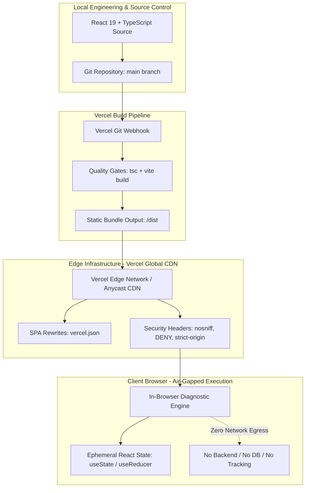

# Production Deployment Plan — Bereit? (A1 German Exam Readiness Check)

This document provides the definitive, production-grade deployment plan for **Bereit?**, the rapid, privacy-first diagnostic web application for learners preparing for the Goethe-Zertifikat A1 (*Start Deutsch 1*) and ÖSD Zertifikat A1 examinations.

It synthesizes the product requirements from [context.md](file:///c:/Nextleap%20Projects%20Git/Bereit/context.md), technical specifications from [architecture.md](file:///c:/Nextleap%20Projects%20Git/Bereit/architecture.md), and Phase 8 execution milestones from [implementation_plan.md](file:///c:/Nextleap%20Projects%20Git/Bereit/implementation_plan.md).

---

## 1. Executive Deployment Strategy

| Parameter | Specification |
|---|---|
| **Product Name** | **Bereit?** (*Know before you book*) |
| **Primary Deployment Platform** | **Vercel** (Global Edge Network / Serverless Static Distribution) |
| **Secondary / Fallback Platforms** | **Netlify** / **Cloudflare Pages** |
| **Backend Architecture** | **Zero Backend / Pure Client-Side SPA** (No database, server processes, or external API endpoints) |
| **Runtime Environment** | 100% in-browser deterministic execution (React 19 + TypeScript 7.0 + Vite 8.3) |
| **Build Artifact** | Immutable static distribution bundle (`/dist`: minified HTML, CSS, JS, SVG assets) |
| **Data Privacy Posture** | **Air-gapped from telemetry**: Zero tracking pixels, zero analytics SDKs, zero cookies, zero PII egress |

---

## 2. Deployment Topology & Architecture

The application adheres to a zero-trust, static client-side distribution model. Assets are distributed globally through Vercel's Edge Network with strict security headers and instant SPA route resolution.



---

## 3. Configuration & Infrastructure Specifications

### 3.1 Primary Platform Configuration: `vercel.json`
The project includes a root-level [vercel.json](file:///c:/Nextleap%20Projects%20Git/Bereit/vercel.json) configuring the build lifecycle, Single Page Application routing, and enterprise-grade HTTP security headers:

```json
{
  "buildCommand": "npm run build",
  "outputDirectory": "dist",
  "rewrites": [
    { "source": "/(.*)", "destination": "/index.html" }
  ],
  "headers": [
    {
      "source": "/(.*)",
      "headers": [
        { "key": "X-Content-Type-Options", "value": "nosniff" },
        { "key": "X-Frame-Options", "value": "DENY" },
        { "key": "Referrer-Policy", "value": "strict-origin-when-cross-origin" }
      ]
    }
  ]
}
```

#### Rationale for Configuration:
* **`buildCommand: "npm run build"`**: Invokes `tsc -b && vite build` ensuring strict TypeScript verification prior to rollup bundle emission.
* **`outputDirectory: "dist"`**: Points Vercel directly to Vite's optimized asset output directory.
* **`rewrites`**: Prevents 404 errors on deep linking or page reloads by routing all paths to the root `index.html`.
* **Security Headers**:
  - `X-Content-Type-Options: nosniff`: Prevents MIME-type sniffing.
  - `X-Frame-Options: DENY`: Prevents clickjacking and unauthorized iframe embeds.
  - `Referrer-Policy: strict-origin-when-cross-origin`: Minimizes referrer leakage.

### 3.2 Secondary Platform Configuration: `netlify.toml`
For multi-cloud resilience, a pre-configured [netlify.toml](file:///c:/Nextleap%20Projects%20Git/Bereit/netlify.toml) is maintained in the root, matching the identical build command and security header posture.

---

## 4. Pre-Deployment Quality Gates

Before any deployment is promoted to production, all four mandatory quality gates must pass cleanly with zero errors:

```
┌─────────────────┐     ┌─────────────────┐     ┌─────────────────┐     ┌─────────────────┐
│  Gate 1: Types  │ ──> │  Gate 2: Lint   │ ──> │  Gate 3: Tests  │ ──> │  Gate 4: Build  │
│  tsc -b --noEmit│     │  oxlint         │     │  vitest run (60)│     │  vite build     │
└─────────────────┘     └─────────────────┘     └─────────────────┘     └─────────────────┘
```

### Execution Commands:

```bash
# Gate 1: Strict TypeScript type checking
npm run typecheck

# Gate 2: Code quality and syntax validation
npm run lint

# Gate 3: Execute comprehensive test suite (60 unit, boundary & a11y tests)
npm run test:run

# Gate 4: Compile production static distribution
npm run build
```

### Automated Test Coverage Checklist (Gate 3):
- [x] **Diagnostic Matrix:** $2 \times 2$ accuracy $\times$ confidence classification (`scoring.test.ts`).
- [x] **Sequential Safeguards:** Weakest-skill $\le 2/4$ rule and blind spots $\ge 3$ rule trigger *"Practise before booking"* (`readiness.test.ts`).
- [x] **Remediation Weights:** Topic error aggregation ($3/2/1/0$) and deterministic tie-breaking (`recommendations.test.ts`).
- [x] **Assessment Session:** Two-step selection gating and backtracking state integrity (`session.test.ts`).
- [x] **Accessibility (WCAG 2.1 AA):** ARIA live announcements, keyboard navigation, color contrast (`a11y.test.tsx`).

---

## 5. Step-by-Step Vercel Deployment Instructions

### Method A: Continuous Deployment via Git Integration (Recommended)

1. **Commit and Push Source Code:**
   Ensure all tracked changes and configuration files are pushed to the remote repository on `main`:
   ```bash
   git add .
   git commit -m "feat(deploy): production deployment configuration for Vercel"
   git push origin main
   ```

2. **Import Repository in Vercel:**
   - Log in to the [Vercel Dashboard](https://vercel.com).
   - Click **Add New...** $\rightarrow$ **Project**.
   - Select your Git provider and repository (`ProductManagerFellowshipGraduationProject` or dedicated `bereit` repo).

3. **Configure Project Settings:**
   - **Project Name:** `bereit-a1-readiness` (or desired custom alias).
   - **Framework Preset:** `Vite` (automatically detected).
   - **Root Directory:** If deploying from a monorepo or parent directory, set to `Bereit`. If deploying from the repository root, leave as `./`.
   - **Build Command:** `npm run build` (or leave default).
   - **Output Directory:** `dist` (automatically detected).
   - **Environment Variables:** **None required** (leave completely blank).

4. **Deploy:**
   - Click **Deploy**. Vercel will clone the branch, run `npm run build`, and provision a globally distributed edge URL (e.g., `https://bereit-a1-readiness.vercel.app`).

---

### Method B: Direct CLI Deployment (Terminal Deploy)

For immediate manual deployments or preview environments:

1. **Install Vercel CLI (if not already present):**
   ```bash
   npm install -g vercel
   ```

2. **Authenticate CLI:**
   ```bash
   vercel login
   ```

3. **Preview Deployment (Testing):**
   Run from the `c:\Nextleap Projects Git\Bereit` directory:
   ```bash
   vercel
   ```
   Follow the interactive prompts to link or create the project.

4. **Production Deployment:**
   ```bash
   vercel --prod
   ```

---

## 6. Environment Variables & Secrets Matrix

While the core diagnostic scoring engine remains 100% deterministic, offline, and air-gapped on the client, an optional serverless AI German tutor (`api/tutor.ts`) is available to answer student questions and explain German grammatical nuances using **Groq LLaMA 3.1** (`llama-3.1-8b-instant`):

| Variable | Required | Default | Scope | Purpose |
|---|---|---|---|---|
| `GROQ_API_KEY` | Optional | *Unset (Offline Mode)* | Serverless / Edge Runtime | Authenticates `api/tutor.ts` with Groq API for interactive A1 grammar explanations. Free key from console.groq.com. If unset, app gracefully displays offline guidance. |
| `NODE_ENV` | Optional | `production` | Build time | Enables Vite minification and tree-shaking |
| *Database URLs* | **None** | — | — | Pure ephemeral in-memory state |
| *Auth Tokens* | **None** | — | — | Zero tracking, zero user accounts, zero cookies |

---

## 7. Post-Deployment Verification & Smoke Testing Protocol

Upon completion of the production deployment, execute the following smoke tests against the live URL:

### 7.1 Functional Workflow Validation
- [ ] **Landing View:** Verify landing page hero renders with clear scope disclaimers (evaluates Vocabulary, Grammar, Reading; excludes Speaking/Listening).
- [ ] **Assessment Runner:**
  - Verify Question 1 renders without answers pre-selected.
  - Verify **Continue** button remains disabled until an answer is clicked.
  - Verify selecting an option dynamically displays the confidence selector (*"Sicher"* vs *"Ich habe geraten"*).
  - Verify **Continue** activates only after both choices are made.
- [ ] **Backtrack Integrity:** Navigate to Question 3, click **Zurück**, and verify Question 2 retains its exact selected answer and confidence choice.
- [ ] **Results Dashboard:** Complete all 12 questions and verify:
  - The Readiness Banner displays with correct category color, icon, and honest explanation.
  - Per-skill breakdown displays fractions (e.g. `3/4`) and diagnostic states.
  - Up to 3 prioritized practice actions appear with concrete next steps.
  - The **Mistake Review** accordion expands to show incorrect choices and explanatory notes.
- [ ] **Restart CTA:** Click *"Diagnose wiederholen"* and confirm the assessment resets cleanly to Question 1 with memory wiped.

### 7.2 Non-Functional & Security Audit
- [ ] **Network Egress Audit:** Open Chrome DevTools $\rightarrow$ *Network* tab. Filter by `Fetch/XHR`. Take the entire assessment. Confirm **zero requests** are made during the assessment and results display.
- [ ] **Responsive Design Audit:** Inspect under mobile viewports ($375\text{ px}$ iPhone SE, $414\text{ px}$ iPhone XR) and desktop ($1440\text{ px}$). Ensure tap targets measure $\ge 44 \times 44\text{ px}$.
- [ ] **Accessibility (WCAG 2.1 AA):** Complete the assessment using only keyboard (`Tab`, `Space`, `Enter`). Confirm focus rings are visible on all interactive cards.
- [ ] **Security Headers:** Inspect HTTP response headers via `curl -I https://<your-vercel-domain>.vercel.app`:
  - `X-Content-Type-Options: nosniff`
  - `X-Frame-Options: DENY`
  - `Referrer-Policy: strict-origin-when-cross-origin`

---

## 8. Rollback & Incident Response Plan

Because Bereit? compiles into an immutable static bundle without stateful database migrations, rollbacks are instantaneous and zero-downtime:

1. **Instant Vercel Instant Rollback:**
   - In the Vercel Dashboard, navigate to **Deployments**.
   - Locate the previous stable production deployment.
   - Click the three dots (`...`) menu $\rightarrow$ **Promote to Production**.
   - Traffic transitions to the previous build across the global CDN within seconds.

2. **Git-Level Rollback:**
   ```bash
   git revert HEAD
   git push origin main
   ```
   The Vercel Git webhook will automatically trigger a clean build and re-deploy.

---

## 9. Maintenance & Operating Costs

* **Hosting Tier:** 100% eligible for Vercel Hobby (Free Tier) or Pro.
* **Bandwidth Overhead:** Minimal ($\sim 336\text{ KB}$ gzipped per cold visit; cached indefinitely via hashed assets).
* **Maintenance Requirements:** Zero server patching, zero database vacuuming, zero secret rotations. Updates are limited to periodic additions or refreshes of questions in `src/data/questionBank.ts`.

---

*Derived directly from [context.md](file:///c:/Nextleap%20Projects%20Git/Bereit/context.md), [architecture.md](file:///c:/Nextleap%20Projects%20Git/Bereit/architecture.md), and [implementation_plan.md](file:///c:/Nextleap%20Projects%20Git/Bereit/implementation_plan.md).*

