# Phase-Wise Implementation Plan — Bereit? (A1 German Exam Readiness Check)

This document outlines the engineering implementation plan for building **Bereit?**, a rapid, honest diagnostic web application for learners preparing for the Goethe-Zertifikat A1 (*Start Deutsch 1*) and ÖSD Zertifikat A1 exams.

It translates the domain requirements and architectural blueprints defined in [context.md](file:///c:/Nextleap%20Projects%20Git/Assg/context.md), [problem_statement.md](file:///c:/Nextleap%20Projects%20Git/Assg/problem_statement.md), and [architecture.md](file:///c:/Nextleap%20Projects%20Git/Assg/architecture.md) into concrete, actionable engineering phases.

---

## 1. Requirements Traceability Matrix

| Requirement ID | Domain | Specification & Acceptance Target | Target Architecture Module | Verification Strategy |
|---|---|---|---|---|
| **REQ-01** | Content | Exactly 12 curated questions (4 Vocab, 4 Grammar, 4 Reading; 6 foundational, 6 applied). Immutable text, options, explanations. | `src/data/questionBank.ts` | Schema validation & integrity test |
| **REQ-02** | Assessment UI | Two-step capture: Select answer option $\rightarrow$ Prompt confidence (`Sure` vs `I guessed`). Continue disabled until both set. | `src/components/assessment/` | Component interaction & e2e test |
| **REQ-03** | Navigation | Backtrack navigation retains selected answer and confidence without resetting progress. No countdown timers. | `src/hooks/useAssessmentSession.ts` | State machine unit tests |
| **REQ-04** | Diagnostic Engine | $2 \times 2$ Matrix: Correctness $\times$ Confidence $\rightarrow$ Secure Knowledge, Uncertain Knowledge, Known Gap, Blind Spot. | `src/logic/scoring.ts` | Truth-table unit tests |
| **REQ-05** | Per-Skill Metrics | Aggregate accuracy, secure count, uncertain count, known gaps, and blind spots per skill out of 4 (displayed with fractions). | `src/logic/metrics.ts` | Aggregation unit tests |
| **REQ-06** | Readiness Logic | Ordered rule evaluation: 1. `Practise before booking` (weakest $\le 2$ or blind spots $\ge 3$) $\rightarrow$ 2. `Ready to consider` $\rightarrow$ 3. `Almost there`. | `src/logic/readiness.ts` | Boundary condition tests |
| **REQ-07** | Practice Sorter | Recommendation weights ($3/2/1/0$), topic aggregation, stable tie-break by test appearance, top 3 sliced, zero-weight fallback. | `src/logic/recommendations.ts` | Sorter & tie-break tests |
| **REQ-08** | Results & Review | Readiness category, skill cards, 4-state legend, top 3 actions, mistake review drawer with explanations, provisional disclaimer. | `src/components/results/` | Visual inspection & component tests |
| **REQ-09** | Accessibility & UX | Paper-and-ink aesthetic (`#FAF9F5`), WCAG 2.1 AA compliance, keyboard operable, non-color-exclusive state indicators. | `src/index.css` & UI tokens | Contrast audit & keyboard walkthrough |
| **REQ-10** | Privacy & Build | Zero PII, no database/auth, pure client-side execution, fully static production bundle for Vercel/Netlify. | `vite.config.ts` | Build check & network egress audit |

---

## 2. Engineering Roadmap Overview

```mermaid
gantt
    title Bereit? Phase-Wise Engineering Roadmap
    dateFormat  X
    axisFormat %s
    section Phase 1: Foundation
    Environment Setup & Design Tokens       :p1, 0, 1
    section Phase 2: Domain & Content
    TypeScript Schemas & Question Bank       :p2, 1, 2
    section Phase 3: Core Logic
    Scoring, Readiness & Recommendation Engine :p3, 2, 3
    section Phase 4: Test Harness
    Automated Unit Test Suite                :p4, 3, 4
    section Phase 5: State Machine
    Session Hook & Navigation Transitions   :p5, 4, 5
    section Phase 6: Presentation
    Landing, Assessment Runner & Results UI :p6, 5, 7
    section Phase 7: Quality & A11y
    Accessibility Audit & Mobile Polish     :p7, 7, 8
    section Phase 8: Deployment
    Static Build & Production Deployment    :p8, 8, 9
```



---

## 3. Phase-by-Phase Detailed Implementation Roadmap

### Phase 1: Environment Initialization & Design Token Setup
*Goal: Establish a modern, high-performance developer environment with clean asset compilation and strict linting.*

- **1.1 Project Scaffolding:**
  - Initialize React Single Page Application using Vite with TypeScript template:
    ```powershell
    npm create vite@latest . -- --template react-ts
    ```
  - Install dependencies: `clsx`, `tailwind-merge`, `lucide-react`.
  - Install dev dependencies: `tailwindcss`, `postcss`, `autoprefixer`, `vitest`, `@testing-library/react`.
- **1.2 Design System & Tailwind Configuration (`tailwind.config.js`):**
  - Configure color palette according to [architecture.md](file:///c:/Nextleap%20Projects%20Git/Assg/architecture.md):
    - `bg-canvas`: `#FAF9F5` (warm paper)
    - `text-ink`: `#1F2937` (deep charcoal)
    - `text-muted`: `#6B7280` (neutral slate)
    - `brand-blue`: `#2563EB` / `brand-blue-hover`: `#1D4ED8`
    - Semantic state colors: `state-secure` (`#059669`), `state-uncertain` (`#D97706`), `state-gap` (`#4B5563`), `state-blindspot` (`#DC2626`).
- **1.3 Typography Setup:**
  - Import `Bricolage Grotesque` and configure clean system fallback stack in `src/index.css`.
  - Enforce smooth card borders, accessible focus outlines, and paper aesthetic defaults.

---

### Phase 2: Domain Types & Curated Question Bank
*Goal: Encode the immutable 12-question bank and strict TypeScript contracts.*

- **2.1 TypeScript Domain Models (`src/types/diagnostic.ts`):**
  - Define all core interfaces specified in the architecture document:
    - `SkillCategory`: `'vocabulary' | 'grammar' | 'reading'`
    - `CognitiveLevel`: `'foundational' | 'application'`
    - `QuestionOption`, `Question`, `ConfidenceLevel`
    - `DiagnosticState`, `UserResponse`, `SkillScoreSummary`
    - `ReadinessCategory`, `ReadinessEvaluation`, `PracticeRecommendation`, `FullAssessmentResult`.
- **2.2 Approved Question Bank (`src/data/questionBank.ts`):**
  - Construct the immutable array of 12 original diagnostic questions adhering to CEFR A1 standards:
    - **Vocabulary (4 questions):** Everyday places/services (e.g., *Apotheke, Bahnhof*), Food/shopping (e.g., *Gemüse, Bäckerei*), Family/relationships (e.g., *Geschwister, Eltern*), Weather/clothing (e.g., *Winterjacke, regnen*).
    - **Grammar (4 questions):** Accusative articles (e.g., *Ich habe einen...*), Verb conjugation (e.g., irregular *fahren, sehen*), V2 word order (e.g., *Am Sonntag fahre ich...*), Negation (*kein* vs. *nicht*).
    - **Reading (4 questions):** Authentic stimulus contexts:
      - Short personal email (e.g., party invitation).
      - Public informational notice (e.g., library opening hours).
      - Train/bus schedule timetable snippet.
      - Classified ad for an apartment/item.
  - Verify every question includes: `id`, `prompt`, `stimulus` (if applicable), 4 options with exact IDs, `correctOptionId`, grammatically sound German explanation, and topic remediation metadata (`remediationTitle`, `remediationAction`).

---

### Phase 3: Core Diagnostic & Scoring Computation Engine
*Goal: Implement pure, deterministic mathematical and diagnostic logic in isolated modules.*

- **3.1 2×2 Diagnostic Matrix Classifier (`src/logic/scoring.ts`):**
  - Implement `classifyResponse(question: Question, response: UserResponse): EvaluatedQuestionResponse`.
  - Map response combinations:
    - Correct + `'sure'` $\rightarrow$ `'secure_knowledge'` (weight 0)
    - Correct + `'guessed'` $\rightarrow$ `'uncertain_knowledge'` (weight 1)
    - Wrong + `'guessed'` $\rightarrow$ `'known_gap'` (weight 2)
    - Wrong + `'sure'` $\rightarrow$ `'potential_blind_spot'` (weight 3).
- **3.2 Per-Skill Metrics Aggregator (`src/logic/metrics.ts`):**
  - Implement `calculateSkillMetrics(evaluatedResponses: EvaluatedQuestionResponse[]): Record<SkillCategory, SkillScoreSummary>`.
  - Aggregate accuracy count, secure count, uncertain count, known gap count, and blind spot count for each domain out of 4.
- **3.3 Provisional Readiness Rule Evaluator (`src/logic/readiness.ts`):**
  - Implement `evaluateReadiness(skillSummaries: Record<SkillCategory, SkillScoreSummary>, totalBlindSpots: number): ReadinessEvaluation`.
  - Enforce exact sequential logic:
    1. **Safeguard Rule:** If any skill $\le 2$ correct OR total blind spots $\ge 3 \rightarrow$ Return `practise_before_booking`.
    2. **Mastery Rule:** If all skills $\ge 3$ correct-and-sure AND total blind spots $\le 1 \rightarrow$ Return `ready_to_consider_booking`.
    3. **Fallthrough Rule:** Return `almost_there`.
  - Include educational explanations and provisional threshold disclaimers for each category.
- **3.4 Weighted Practice Recommendation Engine (`src/logic/recommendations.ts`):**
  - Implement `generateRecommendations(evaluatedResponses: EvaluatedQuestionResponse[]): PracticeRecommendation[]`.
  - Group weights by `topicTag` and calculate cumulative weights.
  - Sort descending by weight; break ties using first appearance index in `questionBank`.
  - Filter out zero-weight topics and return top 3.
  - If all topics have zero weight, provide the positive maintenance advice.

---

### Phase 4: Automated Test Harness & Verification Suite
*Goal: Provide 100% test coverage over diagnostic logic and edge cases before UI assembly.*

- **4.1 Test Harness Configuration (`vitest.config.ts`):**
  - Configure Vitest for fast, headless unit test execution.
- **4.2 Test Suite Implementation:**
  - `tests/scoring.test.ts`: Test all 4 permutations of the $2 \times 2$ matrix.
  - `tests/metrics.test.ts`: Verify count integrity across 4-question skill buckets.
  - `tests/readiness.test.ts`:
    - Case A: Weakest skill failure (e.g., Vocab 4/4, Reading 4/4, Grammar 2/4 $\rightarrow$ `practise_before_booking`).
    - Case B: Blind spot threshold (3 blind spots with 9/12 accuracy $\rightarrow$ `practise_before_booking`).
    - Case C: Clean mastery (Vocab 4/4 sure, Grammar 3/4 sure, Reading 3/4 sure $\rightarrow$ `ready_to_consider_booking`).
    - Case D: Borderline / guessed accuracy (10/12 correct, but only 1/4 sure in Grammar $\rightarrow$ `almost_there`).
  - `tests/recommendations.test.ts`: Validate weight calculation, tie-breaking order, and perfect-score fallback.
  - `tests/questionBank.test.ts`: Verify 12 questions exist, exactly 4 options per question, exactly 1 correct key matches an option ID.

---

### Phase 5: State Machine & Step Navigation Orchestrator
*Goal: Manage session transitions, back/forward history, and selection validation without memory corruption.*

- **5.1 Session State Hook (`src/hooks/useAssessmentSession.ts`):**
  - Manage state: `currentScreen`, `currentQuestionIndex`, `responses`, `isResetModalOpen`.
  - Implement actions:
    - `startAssessment()`: Transition to `assessment`, index 0.
    - `selectOption(questionId, optionId)`: Record/update selected answer.
    - `selectConfidence(questionId, confidence)`: Record/update confidence level.
    - `nextQuestion()`: Validate selection, advance index; on index 11, compute results and transition to `results`.
    - `previousQuestion()`: Decrement index, preserving existing selections.
    - `openResetModal()`, `confirmReset()`, `cancelReset()`.
- **5.2 Validation Guards:**
  - Enforce invariant: `canContinue` is `true` if and only if `responses[currentQuestion.id]` contains both a defined `selectedOptionId` and `confidence`.

---

### Phase 6: Presentation Layer & UI Component Engineering
*Goal: Build the responsive, accessible, calm paper-and-ink interface.*

- **6.1 Layout & Common Elements (`src/components/layout/`, `common/`):**
  - `Header.tsx`: Subtle logo (*Bereit?*), tagline, and discreet "Restart" button when test is active.
  - `Card.tsx`, `Badge.tsx`, `Button.tsx`: Base UI primitives.
  - `ConfirmModal.tsx`: Accessible dialog confirming test reset.
- **6.2 Landing Page (`src/components/landing/`):**
  - `LandingHero.tsx`: Clear value proposition, 5–8 min duration, 12 questions.
  - `ScopeNotice.tsx`: Explicit card detailing what is tested (Vocab, Grammar, Reading) and what is excluded (Listening, Speaking, Writing).
  - Explicit disclaimer: Diagnostic tool, not an official certification.
  - Primary button: `[ Start Assessment ]`.
- **6.3 Assessment Runner (`src/components/assessment/`):**
  - `ProgressBar.tsx`: Clean progress tracker (`Frage 4 von 12` / `Question 4 of 12`).
  - `StimulusCard.tsx`: Distinctly styled container for reading stimuli (notices, emails, schedules).
  - `OptionGroup.tsx`: 4 accessible option cards with clear hover/selected states and radio indicators.
  - `ConfidenceSelector.tsx`: Smoothly revealed 2-choice prompt (`"How sure are you about this answer?"` $\rightarrow$ `Sure` / `I guessed`).
  - `NavigationBar.tsx`: `Back` button (visible Q2+) and `Continue` / `See Results` button (disabled until selections valid).
- **6.4 Results Dashboard (`src/components/results/`):**
  - `ReadinessBanner.tsx`: High-impact status banner with colored badge, plain-language rationale, and provisional threshold note.
  - `SkillBreakdownGrid.tsx`: 3 skill cards (Vocabulary, Grammar, Reading) showing accuracy fraction (`3 of 4`), accuracy bar, and breakdown of the 4 diagnostic states with icons.
  - `DiagnosticLegend.tsx`: Educational drawer explaining the meaning of Secure Knowledge, Uncertain Knowledge, Known Gap, and Potential Blind Spot.
  - `PracticePriorityList.tsx`: Top 3 ranked recommendations showing topic tag, rationale, and concrete practice instruction.
  - `MistakeReviewDrawer.tsx`: Accordion/card review showing every incorrect question: learner's answer, correct answer, and explanation.
  - `AssessmentDisclaimers.tsx`: Clear statement of test limitations.
  - `RestartCTA.tsx`: Clean button to begin a fresh attempt.

---

### Phase 7: Accessibility (a11y), Polish & Responsive Verification
*Goal: Ensure the application is universally accessible, frictionless, and visually refined.*

- **7.1 Accessibility Standards (WCAG 2.1 AA):**
  - Verify contrast ratios exceed $4.5:1$ across all text elements.
  - Ensure every diagnostic state pairs color with a distinct icon and text label (no color-only encoding).
  - Add full keyboard navigation support: Tab navigation, Enter/Space selection, focus rings.
  - Add ARIA attributes (`aria-live`, `aria-describedby`, `role="radiogroup"`).
- **7.2 Responsive Layout Verification:**
  - Audit viewports from 375px mobile (iPhone SE) to 1440px desktop.
  - Ensure touch targets for answer options and confidence buttons are at least $44 \times 44\text{ px}$.
- **7.3 Edge Case & State Polish:**
  - Verify back-navigation restores selections flawlessly.
  - Verify browser refresh prompt warns about progress loss.

---

### Phase 8: Build Optimization, Documentation & Production Launch
*Goal: Generate an optimized static distribution and document deployment.*

- **8.1 Production Build & Bundle Optimization:**
  - Execute `npm run build` to verify clean TypeScript compilation and zero bundle warnings.
  - Verify zero external API calls or CDN trackers in network tab.
- **8.2 Documentation (`README.md`):**
  - Document project overview, local development setup (`npm install`, `npm run dev`), test execution (`npm test`), scoring logic summary, and deployment instructions for Vercel/Netlify.
- **8.3 Production Deployment:**
  - Deploy static assets to host platform (e.g. Vercel / Cloudflare Pages).
  - Verify live production URL across mobile and desktop browsers.

---

## 4. Verification & Quality Gates

Each phase requires explicit verification before advancing:

```powershell
# 1. Execute full unit test suite
npm run test:run

# 2. Execute TypeScript type checking
npm run typecheck

# 3. Execute linting & style validation
npm run lint

# 4. Build production static bundle
npm run build
```

### Acceptance Checklist
- [x] Exactly 12 approved questions loaded across Vocabulary, Grammar, and Reading.
- [x] Two-step selection (Answer $\rightarrow$ Confidence) required before Continue activates.
- [x] Backtrack navigation preserves all previous inputs without resetting.
- [x] Diagnostic classification maps all 4 states accurately.
- [x] Readiness thresholds enforce the weakest-skill safeguard ($\le 2$ correct $\rightarrow$ *Practise before booking*).
- [x] Recommendations prioritize blind spots (weight 3) and known gaps (weight 2) with deterministic tie-breaking.
- [x] Results screen provides skill breakdown, mistake review, and disclaimers.
- [x] App is 100% client-side with zero PII transmission.

---

*Derived from [context.md](file:///c:/Nextleap%20Projects%20Git/Assg/context.md), [problem_statement.md](file:///c:/Nextleap%20Projects%20Git/Assg/problem_statement.md), and [architecture.md](file:///c:/Nextleap%20Projects%20Git/Assg/architecture.md)*

